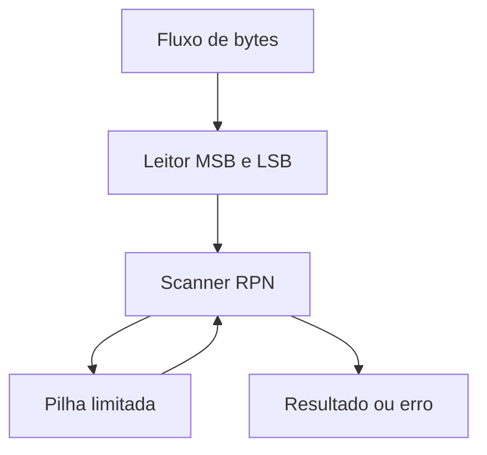

# Arquitetura, memória e ABI

## Mapa de memória hexadecimal

| Posição / região | Função |
| --- | --- |
| 0000–02FF | Programa principal; harness usa 0000 e 0002 |
| 0300 / 0304 / 0306 | Leitor / resultado / argumento reservado |
| 0500 / 0504 / 0506 / 0508 | Push / argumento / salto de erro / status |
| 0700 / 0704 / 0706 / 0708 | Pop / resultado / salto de erro / status |
| 0900 / 0904 / 0906 / 0908 | RPN / resultado / salto de erro / status |
| 0E00 em diante | Constantes compartilhadas |
| 0F00–0FFD | Reserva da pilha, palavras alinhadas em 0F00…0FFC |
| 0FFE | Palavra que guarda stack pointer |

São 254 bytes reservados para a pilha, portanto 127 palavras. Push verifica cheio antes de decrementar SP em dois; pop verifica vazio antes de ler e incrementa depois. Para acesso indireto, o programa altera o operando de instruções LD/MM previamente reservadas. Isso é código automodificável e não reentrante.

SC guarda endereço de retorno na palavra de entrada e transfere para entrada+2; RS carrega esse retorno. Argumentos/resultados e status ficam em memória compartilhada. Os handlers de erro em 0506/0706/0906 são saltos; os status em 0508/0708/0908 são extensão desta reconstrução.

## Byte e palavra

GD /300 devolve dois bytes do fluxo em ordem big-endian no modelo. O leitor alterna alto/baixo com cache e flag. Para byte alto ≥128, a palavra é negativa sob divisão com sinal: o programa retira o bit alto por soma modular, divide a parte positiva e repõe 128 no byte retornado. O byte baixo é obtido subtraindo a palavra recomposta. Todos os resultados de byte estão entre 0 e 255.

No contrato de RPN, 00 encerra a expressão. Não se distingue NUL literal do EOF preenchido com zero. LE_BYTE_ARG ocupa o endereço recuperado, mas o dispositivo implementado é fixo: disco 0. Seleção de outros dispositivos não está implementada.

## Scanner RPN

Dígitos decimais acumulam números não negativos. Espaço, tab e CR separam tokens; LF ou 00 encerram. Em um operador, desempilha-se primeiro o direito e depois o esquerdo. Ao encerrar, deve haver exatamente um valor. Falta/excesso de operandos, operador desconhecido, divisão por zero ou overflow da pilha sinaliza erro.

Aritmética é modular de 16 bits: literais grandes e operações podem dar wrap. Divisão usa sinal e trunca para zero. `32767 1 +` resulta −32768 e `0 7 - 2 /` resulta −3. O executor aceita no máximo 200.000 instruções por chamada; isso detecta ausência de término, não mede performance real.

## Montador e executor próprios

Formato aceito: `@ /origem`, rótulos, `K /palavra`, instrução e operando hexadecimal ou símbolo. Duas passagens resolvem símbolos e recusam rótulos duplicados, sobreposição e posições desalinhadas. Os bytes são big-endian, opcode em quatro bits e operando em 12. Não implementa objetos relocáveis ou ligação externa oficial. O modelo executa apenas o subconjunto fornecido; PD/OS não estão implementados. Compatibilidade com simulador oficial exige validação separada.
